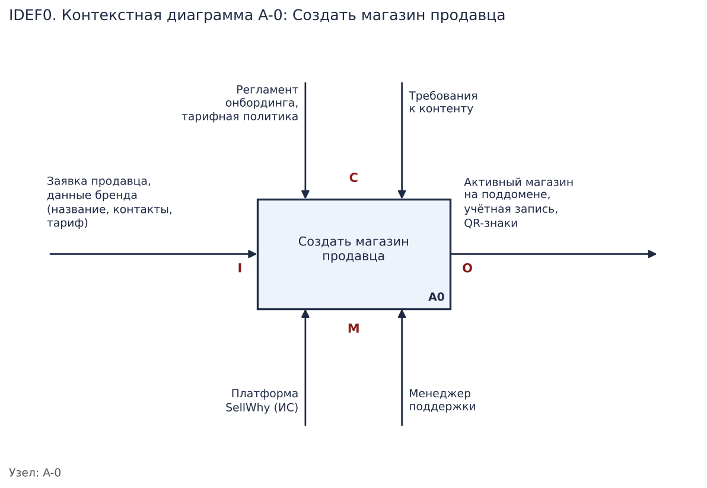
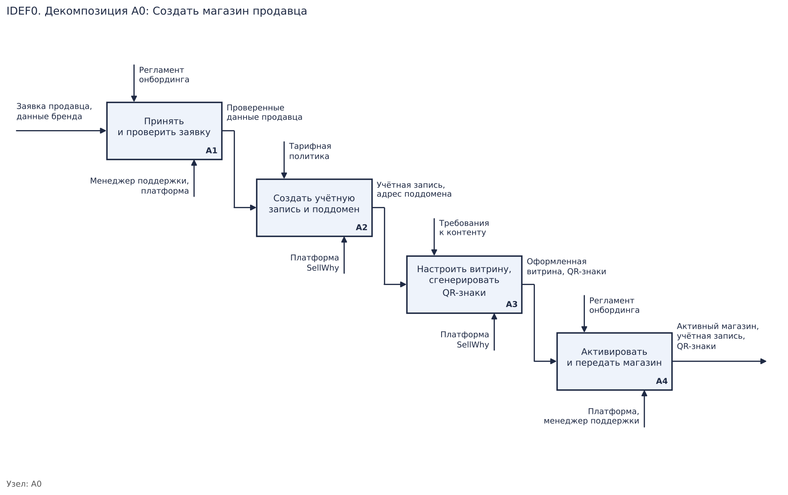

# Описание итоговой IDEF0-модели

**Моделируемая функция:** «Создать магазин продавца на платформе SellWhy».

## Контекстная диаграмма A-0

Один блок «Создать магазин продавца». Расшифровка граничных дуг:

| Тип дуги | Сторона | Конкретное содержание |
|----------|---------|------------------------|
| Input (вход) | слева | Заявка продавца, данные бренда (название, контакты, тариф) |
| Control (управление) | сверху | Регламент онбординга, тарифная политика, требования к контенту |
| Output (выход) | справа | Активный магазин на поддомене, учётная запись продавца, QR-знаки |
| Mechanism (механизм) | снизу | Платформа SellWhy (ИС), менеджер поддержки |

## Декомпозиция A0

Контекстная функция раскрыта на четыре блока:

- **A1 «Принять и проверить заявку»** — вход: заявка продавца; управление: регламент
  онбординга; механизм: менеджер поддержки, платформа; выход: проверенные данные продавца.
- **A2 «Создать учётную запись и поддомен»** — вход: проверенные данные (выход A1); управление:
  тарифная политика; механизм: платформа SellWhy; выход: учётная запись, адрес поддомена.
- **A3 «Настроить витрину и сгенерировать QR-знаки»** — вход: учётная запись и поддомен
  (выход A2); управление: требования к контенту; механизм: платформа; выход: оформленная
  витрина, QR-знаки.
- **A4 «Активировать и передать магазин продавцу»** — вход: оформленная витрина (выход A3);
  управление: регламент онбординга; механизм: платформа, менеджер поддержки; выход: активный
  магазин (граничный выход всей системы).

## Логика декомпозиции

Подфункции выбраны по естественным этапам онбординга: сначала заявка проверяется, затем
создаётся техническая основа (учётка и поддомен), затем оформляется содержимое (витрина и
QR-знаки) и, наконец, магазин активируется и передаётся продавцу. Блоки связаны
последовательно по принципу «выход предыдущего — вход следующего», что обеспечивает
связность дуг. Согласованность границ соблюдена: вход A-0 (заявка) приходит в A1, выход A-0
(активный магазин) выходит из A4, управление (регламент, тарифы, требования к контенту) и
механизмы (платформа, поддержка) распределены по соответствующим блокам.
